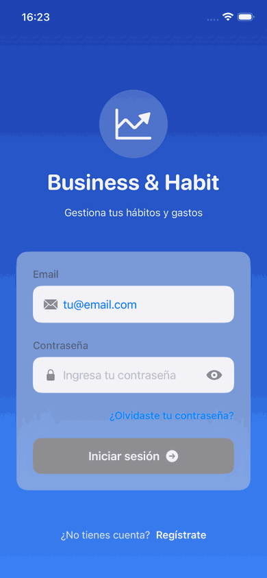
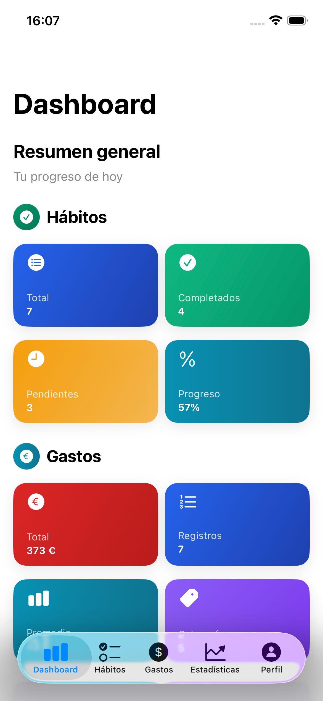
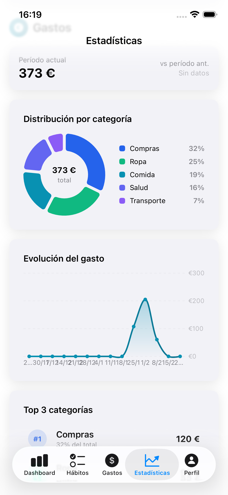
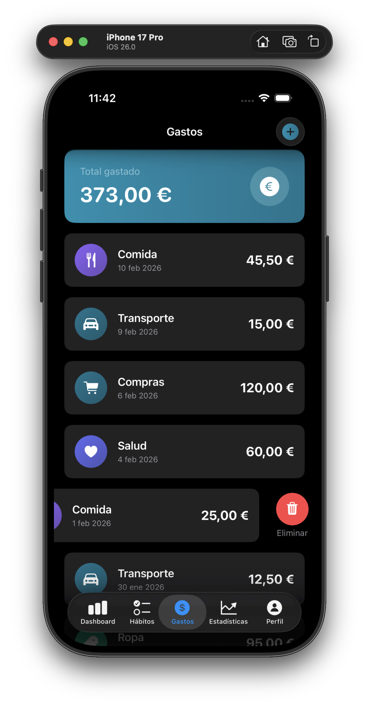
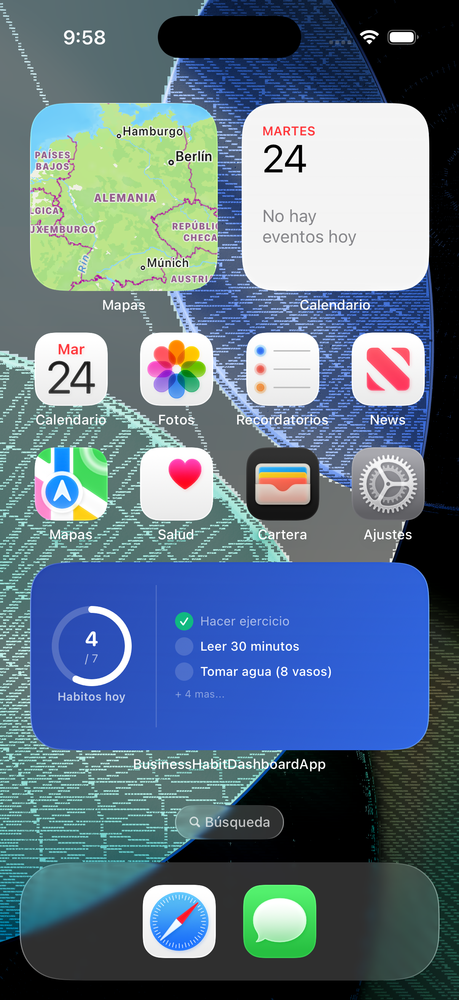

# Business & Habit Dashboard iOS

App iOS profesional (SwiftUI + MVVM) para seguimiento de hábitos y gastos, conectada a Supabase con autenticación segura.

## 📸 Demo



| Dashboard | Estadísticas | Swipe to delete | Widget |
|-----------|--------------|-----------------|--------|
|  |  |  |  |

---

## ✅ Características implementadas

- ✅ **Arquitectura MVVM** separada por capas
- ✅ **Autenticación**:
  - Sign Up con validación de contraseña
  - Login con normalización de emails
  - Logout con confirmación
  - **Reset password con deep links** (recuperación por email)
  - Vistas separadas con diseño moderno
  - Confirmación de contraseña en tiempo real
  - Botones para mostrar/ocultar contraseñas
  - **Mensajes de error amigables en español** (sin JSON técnico)
  - Manejo de errores específicos (credenciales inválidas, rate limit, etc.)
  - Sesión persistente con JWT
  - **Deep linking** para recuperación de contraseña (URL scheme: `businesshabit://reset-password`)
- ✅ **Gestión de Hábitos**:
  - CRUD completo (crear, leer, actualizar, eliminar)
  - **Swipe-to-delete** para eliminar hábitos de forma rápida
  - **Notificaciones locales** para recordatorios de hábitos
  - Configuración personalizada: días de la semana y hora
  - Indicador visual de recordatorios activos (icono de campana)
  - API integrada con Supabase
- ✅ **Gestión de Gastos**:
  - CRUD completo por categorías
  - **Swipe-to-delete** para eliminar gastos de forma rápida
  - API integrada con Supabase
  - Formato de moneda en euros (€)
- ✅ **Perfil de Usuario**:
  - Vista de perfil con información del usuario
  - Botón de logout con confirmación
  - Opciones de actualización de email y contraseña
- ✅ **Dashboard**:
  - 8 métricas en tiempo real (hábitos y gastos)
  - Métricas de hábitos: total, completados, pendientes, progreso %
  - Métricas de gastos: total €, promedio €, registros, categorías
  - Gráficos profesionales con **Swift Charts** (barras y dona)
  - Animaciones y diseño con gradientes corporativos
- ✅ **Estadísticas avanzadas**:
  - Filtros por período: semana, mes, 3 meses y año
  - Racha actual y mejor día de la semana
  - Tasa de completación por hábito
  - Distribución de gastos por categoría (gráfico dona)
  - Evolución temporal del gasto (gráfico de línea)
  - Comparativa vs período anterior con % de cambio
  - Top 3 categorías de gasto
- ✅ **Exportación de datos**:
  - Exportar hábitos, gastos o todo a CSV
  - Share sheet nativo de iOS para compartir o guardar
  - Formato CSV con cabeceras en español
- ✅ **Diseño Visual Profesional**:
  - Sistema de colores corporativo (azul, verde, índigo)
  - Gradientes sutiles y profesionales
  - Animaciones spring suaves en todas las vistas
  - Haptic feedback en acciones importantes
  - Onboarding interactivo de 4 pantallas (primera vez)
  - Empty states motivacionales con SF Symbols
  - Cards con sombras y efectos de profundidad
  - Soporte completo para light/dark mode
- ✅ **Seguridad**:
  - Credenciales en archivo separado (no en código)
  - Sistema de template para desarrollo colaborativo
  - `.gitignore` configurado para proteger credenciales

> 🔒 **Proyecto listo para ser público**: Las credenciales nunca se suben a git.

---

## 📁 Estructura del proyecto

```text
BusinessHabitDashboardApp/
├── BusinessHabitDashboardApp.xcodeproj
├── Info.plist                          # Info.plist source (variables serán inyectadas)
├── Secrets.xcconfig                    # 🔒 TUS CREDENCIALES (gitignored)
├── Secrets-template.xcconfig           # Plantilla para configurar
├── .gitignore                          # Protección de credenciales
├── SETUP_SEGURO.md                     # Guía de configuración segura
└── BusinessHabitDashboardApp/
    ├── Models/
    │   ├── Habit.swift                 # Modelo de hábitos
    │   ├── Expense.swift               # Modelo de gastos
    │   ├── SessionUser.swift           # Modelo de sesión
    │   └── OnboardingPage.swift        # Modelo de onboarding
    ├── Theme/
    │   ├── AppColors.swift             # Sistema de colores profesional
    │   └── AppStyles.swift             # Estilos y componentes reutilizables
    ├── Services/
    │   ├── SupabaseConfig.swift            # Configuración de Supabase
    │   ├── SupabaseCredentials.swift       # 🔒 TUS CREDENCIALES (gitignored)
    │   ├── SupabaseCredentials.swift.template  # Template sin credenciales
    │   ├── AuthService.swift               # Servicio de autenticación
    │   ├── APIClient.swift                 # Cliente HTTP genérico
    │   ├── HabitService.swift              # CRUD de hábitos
    │   ├── ExpenseService.swift            # CRUD de gastos
    │   ├── NotificationManager.swift       # Gestor de notificaciones locales
    │   └── ExportService.swift             # Exportación de datos a CSV
    ├── ViewModels/
    │   ├── AuthViewModel.swift         # Lógica de autenticación
    │   ├── HabitViewModel.swift        # Lógica de hábitos
    │   ├── ExpenseViewModel.swift      # Lógica de gastos
    │   └── StatsViewModel.swift        # Lógica de estadísticas avanzadas
    ├── Views/
    │   ├── OnboardingView.swift        # Bienvenida interactiva (primera vez)
    │   ├── LoginView.swift             # Pantalla de login
    │   ├── SignUpView.swift            # Pantalla de registro
    │   ├── ForgotPasswordView.swift    # Solicitud de reset password
    │   ├── ResetPasswordView.swift     # Cambio de contraseña con deep link
    │   ├── DashboardView.swift         # Dashboard principal
    │   ├── HabitsView.swift            # Lista de hábitos
    │   ├── HabitReminderView.swift     # Configuración de recordatorios
    │   ├── StatsView.swift             # Estadísticas avanzadas con gráficos
    │   ├── ExportView.swift            # Exportación de datos a CSV
    │   ├── ExpensesView.swift          # Lista de gastos (formato EUR)
    │   ├── ProfileView.swift           # Perfil de usuario con logout
    │   └── RootView.swift              # Vista raíz con navegación por tabs
    └── Docs/
        └── SUPABASE_SETUP.md           # Instrucciones de Supabase
```

---

## 🚀 Setup rápido (5 minutos)

### 1️⃣ Configurar Supabase

1. Crea un proyecto gratuito en [supabase.com](https://supabase.com)
2. Crea las tablas `habits` y `expenses` (SQL en `Docs/SUPABASE_SETUP.md`)
3. Activa Row Level Security (RLS) con las políticas incluidas
4. Copia tu **Project URL** y **anon public key**

### 2️⃣ Configurar credenciales (seguro)

```bash
# Copia el template
cd BusinessHabitDashboardApp/Services/
cp SupabaseCredentials.swift.template SupabaseCredentials.swift
```

Edita `SupabaseCredentials.swift` con tus credenciales:

```swift
enum SupabaseCredentials {
    static let projectURL = URL(string: "https://TU-PROYECTO-ID.supabase.co")!
    static let anonKey = "TU_ANON_KEY_AQUI"
}
```

⚠️ **IMPORTANTE**: Este archivo está en `.gitignore` y **NUNCA** se subirá a git.

### 3️⃣ Compilar y ejecutar

1. Abre `BusinessHabitDashboardApp.xcodeproj` en Xcode
2. Selecciona un simulador (iPhone 15 Pro recomendado)
3. ⌘R para compilar y ejecutar
4. Crea una cuenta con "Registrarse"

---

## 🔐 Seguridad de credenciales

Este proyecto usa un **sistema de archivos template**:

✅ **Lo que SÍ está en git:**
- `SupabaseCredentials.swift.template` - Plantilla SIN credenciales
- `SupabaseConfig.swift` - Código que lee las credenciales

❌ **Lo que NUNCA está en git:**
- `SupabaseCredentials.swift` - TUS credenciales reales (gitignored)

**Para otros desarrolladores que clonen el repo:**
```bash
cp SupabaseCredentials.swift.template SupabaseCredentials.swift
# Editar con sus propias credenciales
```

Las credenciales **nunca** están en el código que se sube a git.

---

## 🧭 Roadmap

### ✅ Completado
- [x] Autenticación con Sign Up y Login (vistas separadas)
- [x] Vista de Perfil con botón de Logout y opciones de actualización
- [x] Navegación por tabs: Dashboard / Hábitos / Gastos / Perfil
- [x] Validación de contraseñas en tiempo real
- [x] **Mensajes de error amigables y en español** (sin JSON técnico)
- [x] **Swipe-to-delete** en listas de hábitos y gastos
- [x] **Rediseño visual completo** con paleta profesional
- [x] **Onboarding interactivo** de 4 pantallas
- [x] **Animaciones y haptic feedback** en toda la app
- [x] Soporte para **light/dark mode** con colores optimizados
- [x] **Reset password con deep links** - Recuperación de cuenta por email
- [x] **Notificaciones locales** para recordatorios de hábitos (días y hora personalizable)
- [x] **Estadísticas avanzadas** con filtros por período y gráficos interactivos
- [x] **Exportación de datos a CSV** (hábitos, gastos o todo)
- [x] **Widget para iOS Home Screen** (small y medium, datos en tiempo real)
- [x] **Tests unitarios** — 73 tests de modelos, ViewModels y servicios
- [x] **Sincronización en tiempo real** con Supabase Realtime (WebSocket)
- [x] **Persistencia offline con CoreData** — datos disponibles sin conexión
- [x] CRUD de hábitos con Supabase
- [x] CRUD de gastos con Supabase (formato EUR)
- [x] Dashboard con métricas y gráficos
- [x] Sistema de seguridad para credenciales (template)
- [x] Arquitectura MVVM limpia

---

## 📤 Subir a GitHub (seguro)

```bash
# 1. Inicializar repositorio
git init
git add .
git commit -m "feat: iOS MVVM app with Supabase - initial commit"

# 2. Crear repositorio en GitHub y conectar
git branch -M main
git remote add origin https://github.com/tu-usuario/tu-repo.git
git push -u origin main
```

**✅ Verificación de seguridad antes de push:**
```bash
# Asegúrate de que las credenciales NO se suban
git status

# Deberías ver SOLO el template:
# ✅ BusinessHabitDashboardApp/Services/SupabaseCredentials.swift.template

# NO deberías ver (está en .gitignore):
# ❌ BusinessHabitDashboardApp/Services/SupabaseCredentials.swift

# Si ves el archivo con credenciales, verifica .gitignore
```

---

## 🛠 Tecnologías

- **Swift 5.9+** / **SwiftUI**
- **iOS 17.0+**
- **Supabase** (Backend as a Service)
  - Auth (autenticación)
  - PostgreSQL (base de datos)
  - Row Level Security (RLS)
  - **Realtime** (sincronización en tiempo real vía WebSocket)
  - Supabase Swift SDK
- **Swift Charts** (gráficos nativos)
- **async/await** (concurrencia moderna)
- **MVVM** (arquitectura)

---

## 📝 Licencia

Este proyecto es de código abierto. Úsalo como base para tus propios proyectos.

---

## 🤝 Contribuciones

¡Las contribuciones son bienvenidas! Si encuentras un bug o tienes una mejora:

1. Fork el proyecto
2. Crea una rama (`git checkout -b feature/mejora`)
3. Commit tus cambios (`git commit -m 'feat: nueva característica'`)
4. Push a la rama (`git push origin feature/mejora`)
5. Abre un Pull Request

---

## 👩‍💻 Autor

**Maria Bravo Angulo**
[](https://www.linkedin.com/in/maria-bravo-angulo-363133337/)

---

**Hecho con ❤️ usando SwiftUI y Supabase**

